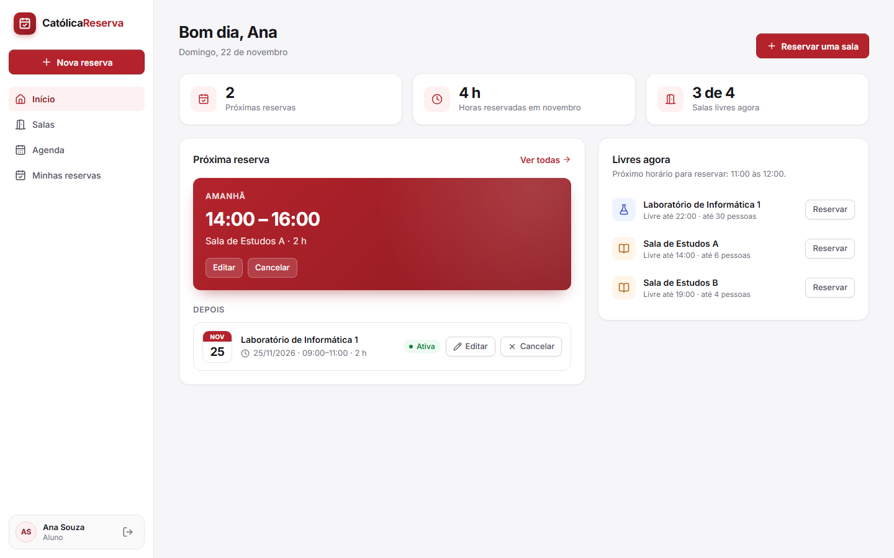
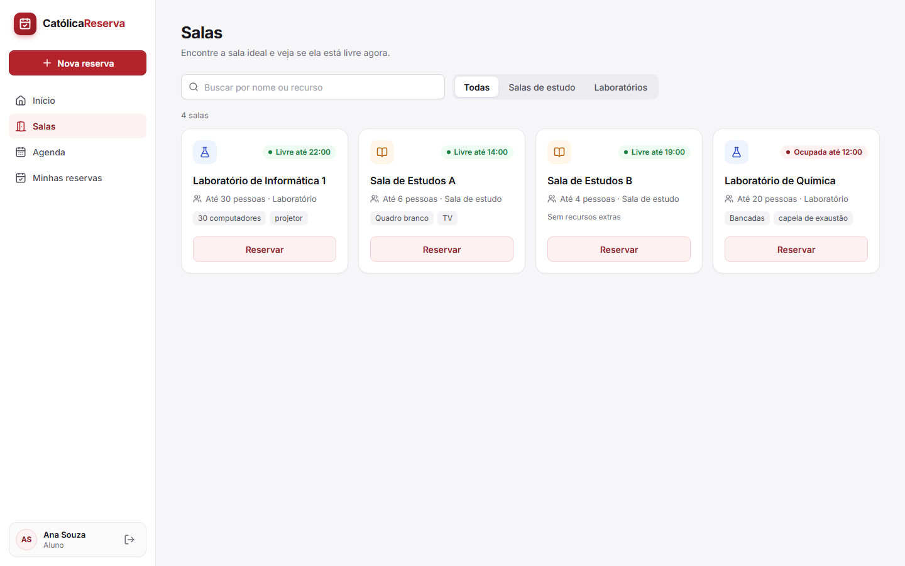
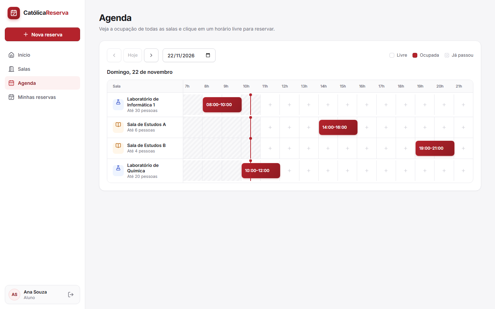
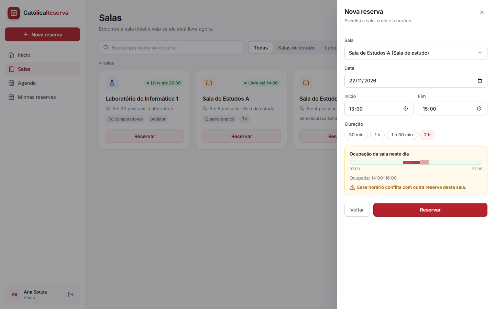
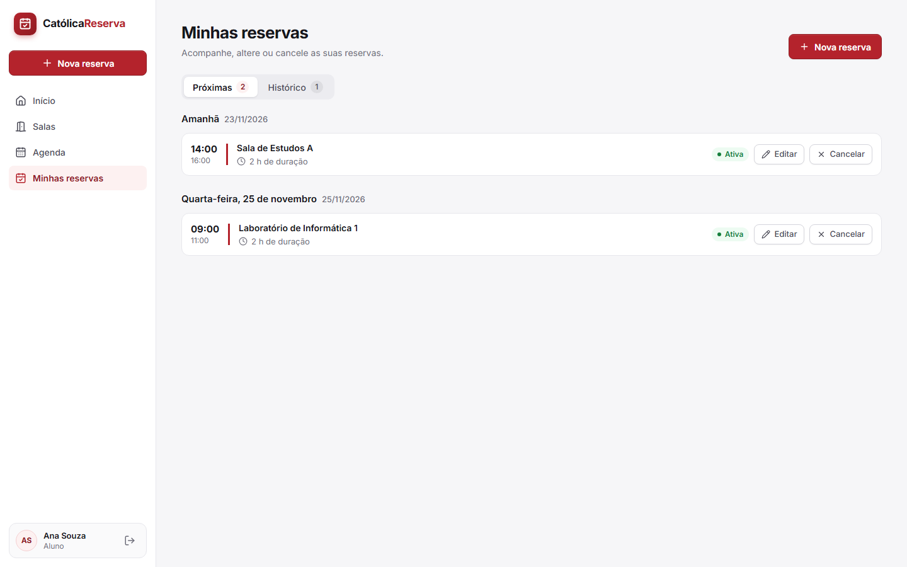
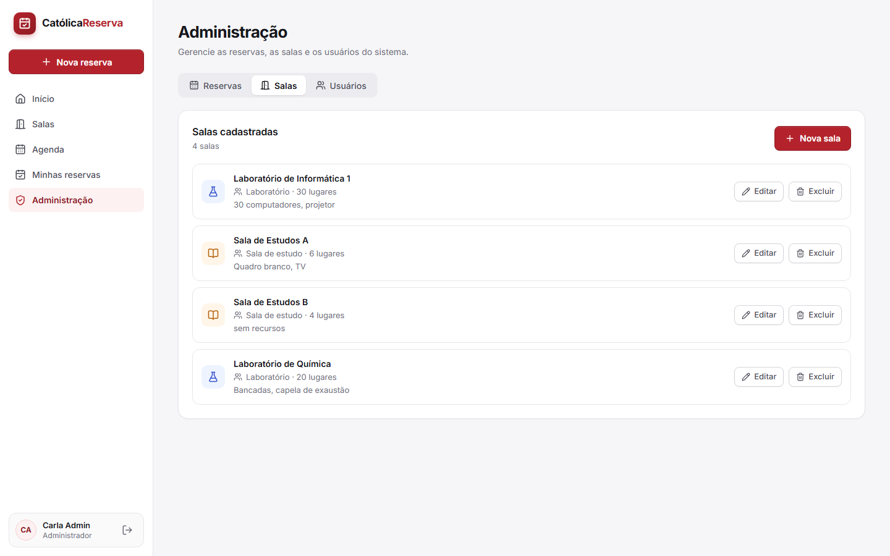
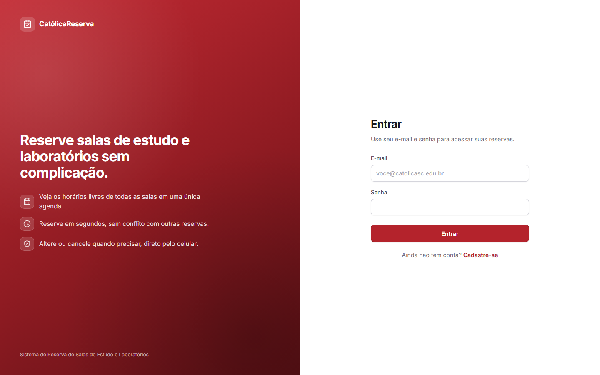
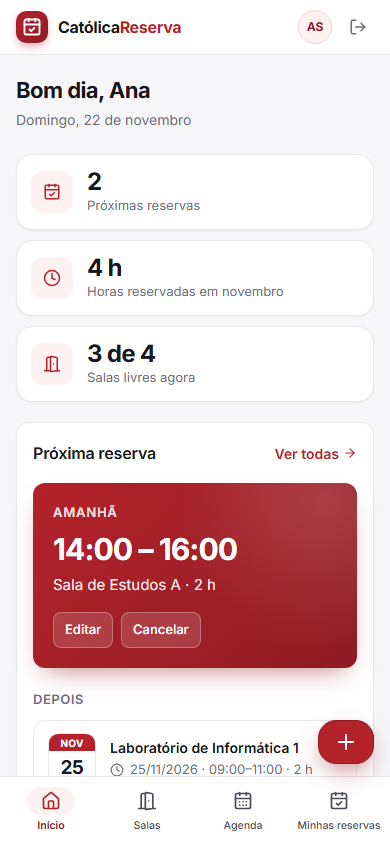
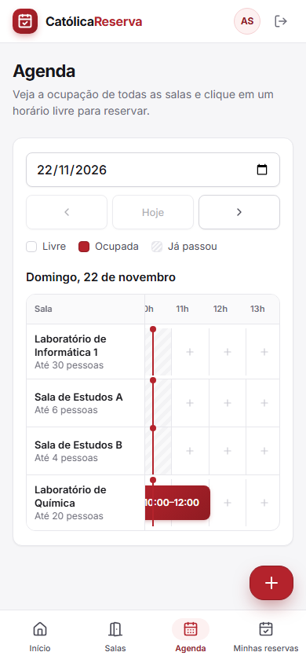
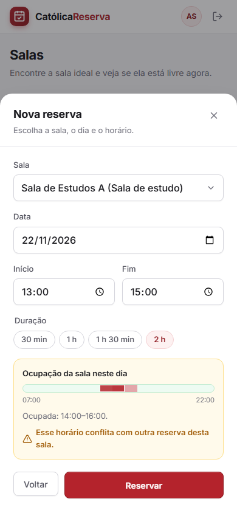

# CatólicaReserva — Sistema de Reserva de Salas de Estudo e Laboratórios

**Disciplina:** Projeto e Arquitetura de Software
**Integrantes:** Gustavo Schmitt e Heric Moreira Ribeiro

Sistema web para reservar salas de estudo e laboratórios, evitando conflitos de horário.
Arquitetura **cliente-servidor**: um cliente web (React) que conversa por uma API REST
com um servidor (Node.js + Express), que por sua vez acessa um banco de dados MySQL.



## Telas

O cliente segue o modelo de um sistema de agendamento moderno: barra lateral com as telas e
o botão **Nova reserva**, que abre um painel lateral de qualquer lugar do sistema. No celular,
a barra lateral vira uma barra de abas embaixo, com um botão flutuante para reservar.

| | |
|---|---|
| **Início** — saudação, resumo (próximas reservas, horas reservadas no mês, salas livres agora), a próxima reserva em destaque e as salas livres para reservar em 1 clique. |  |
| **Salas** — catálogo com busca por nome ou recurso, filtro por tipo, capacidade, recursos e a situação de cada sala agora ("Livre até 14:00", "Ocupada até 12:00"). |  |
| **Agenda** — linha do tempo do dia com uma faixa por sala: as reservas aparecem como blocos, a linha vermelha marca o horário atual e clicar em um horário livre abre a reserva já preenchida. |  |
| **Nova reserva** — painel lateral com atalhos de duração (30 min a 2 h) e a ocupação da sala no dia, avisando o conflito antes de enviar. |  |
| **Minhas reservas** — abas *Próximas* e *Histórico*, agrupadas por dia ("Hoje", "Amanhã"...), com edição e cancelamento (com confirmação). |  |
| **Administração** — todas as reservas com filtros, cadastro de salas no painel lateral e gestão dos usuários. |  |
| **Login e cadastro** — painel da marca e formulário; o cadastro já entra no sistema. |  |

**No celular:**

<p>
  
  
  
</p>

## Estrutura do projeto

```
CatolicaReserva/
├── client/          # Cliente web (React + Vite)
├── server/          # Servidor / API REST (Node.js + Express + MySQL)
├── documentacao/    # Documentação, modelo C4, plano de testes, Sonar e capturas das telas
└── scripts/         # analisar-sonar.ps1 (testes com cobertura + análise do SonarQube)
```

### Cliente

```
client/src/
├── App.jsx            # Login ou área logada; trata a sessão expirada
├── AreaLogada.jsx     # Barra lateral, telas, painel de reserva e confirmações
├── pages/             # Inicio, Salas, Agenda, MinhasReservas, Login, Admin (+ admin/)
├── components/        # Dialogo, PainelReserva, FormularioReserva, ItemReserva, Confirmacao...
├── contexto/          # Ações da área logada (abrir/editar/cancelar reserva) e avisos (toasts)
├── agenda.js          # Regras de exibição: próximas/histórico, situação da sala, linha do tempo
├── formatos.js        # Datas, horas, durações e rótulos
├── validacoes.js      # Validações feitas antes de enviar ao servidor
├── useCarregar.js     # Carrega dados da API e ignora respostas atrasadas
├── api.js             # Chamadas à API REST
└── styles.css         # Tokens de design (cores, raios, sombras) e estilos
```

Visual: fonte [Inter](https://rsms.me/inter/), ícones [Lucide](https://lucide.dev/) e o vermelho
da Católica como cor de destaque. Os diálogos levam o foco para dentro, prendem o Tab e fecham
com Esc; as mensagens são anunciadas pelos leitores de tela.

### Servidor

A pasta `server/` segue a divisão em camadas do modelo C4
(**Controller → Service → Repository**) e os princípios **SOLID**
(ver [documentacao/SOLID.md](./documentacao/SOLID.md)):

```
server/src/
├── config/          # Leitura das variáveis de ambiente (.env)
├── dominio/         # Regras de negócio puras (não conhece Express, MySQL, bcrypt nem JWT)
│   ├── entidades/   #   Reserva, Sala, Usuario
│   ├── contratos/   #   Interfaces: repositórios, hash, token, regras
│   ├── regras/      #   Regras de reserva e de alteração (uma classe por regra)
│   └── erros.js     #   Erros de domínio (sem status HTTP)
├── services/        # Casos de uso: Reserva, Sala, Usuario, GestaoDeUsuarios e Agenda
├── infra/           # Implementações concretas: MySQL, bcrypt, JWT
├── http/            # Controllers, rotas, middlewares e formatação do JSON
├── database/        # schema.sql e seed.sql
├── container.js     # Monta e injeta todas as dependências (Composition Root)
├── app.js           # Configuração do Express
└── server.js        # Ponto de entrada
server/test/         # Testes de unidade, da API HTTP e de integração com o MySQL
```

## Pré-requisitos

- Node.js 20.19+ ou 22.12+ (exigência do Vite)
- MySQL 8 (rodando localmente)

## Como rodar

### 1. Banco de dados e servidor

```bash
cd server
cp .env.example .env      # ajuste usuário/senha do MySQL no arquivo .env
npm install
npm run db:init           # cria o banco, as tabelas e os dados iniciais
npm run dev               # sobe a API em http://localhost:3001
```

O `db:init` cria um administrador:
**e-mail:** `admin@catolicasc.edu.br` · **senha:** `admin123`

### 2. Cliente web

Em outro terminal:

```bash
cd client
npm install
npm run dev               # abre o cliente em http://localhost:5173
```

Acesse `http://localhost:5173`, crie uma conta (ou entre com o admin) e faça uma reserva.

## Testes e qualidade

| Comando | O que roda |
|---|---|
| `cd server && npm test` | 128 testes do servidor: regras, services, contratos, API HTTP, repositórios (sem banco) |
| `cd server && npm run test:integracao` | 9 testes de integração gravando e lendo de um **MySQL real** |
| `cd client && npm test` | 163 testes do cliente (Vitest + Testing Library): todas as telas e componentes |
| `npm run test:coverage` (em cada pasta) | Os mesmos testes com relatório de cobertura (100% nos dois) |

O teste de integração precisa de um MySQL separado só para testes. Por padrão ele usa
`localhost:3307`, usuário `root` e senha `teste`; para usar outro, defina `TEST_DB_HOST`,
`TEST_DB_PORT`, `TEST_DB_USER` e `TEST_DB_PASSWORD`. O banco `catolicareserva_teste` é
recriado a cada execução, e o banco de desenvolvimento nunca é usado.

- Planejamento dos testes: [documentacao/PLANO_DE_TESTES.md](./documentacao/PLANO_DE_TESTES.md)
- SonarQube e SonarLint (zero problemas, 100% de cobertura): [documentacao/SONAR.md](./documentacao/SONAR.md)

## Endpoints da API

| Método | Rota | Descrição | Acesso |
|---|---|---|---|
| POST | `/api/auth/registrar` | Cria um aluno ou professor | público |
| POST | `/api/auth/login` | Faz login e retorna o token | público |
| GET | `/api/salas` | Lista as salas | logado |
| POST | `/api/salas` | Cadastra uma sala | admin |
| PUT | `/api/salas/:id` | Edita uma sala | admin |
| DELETE | `/api/salas/:id` | Exclui uma sala e as reservas dela | admin |
| POST | `/api/reservas` | Cria uma reserva (valida as regras) | logado |
| PUT | `/api/reservas/:id` | Edita uma reserva ativa | dono / admin |
| GET | `/api/reservas/minhas` | Lista as reservas do usuário | logado |
| PATCH | `/api/reservas/:id/cancelar` | Cancela uma reserva | dono / admin |
| GET | `/api/reservas` | Lista todas as reservas | admin |
| GET | `/api/agenda?data=AAAA-MM-DD` | Horários ocupados de todas as salas na data | logado |
| GET | `/api/usuarios` | Lista os usuários | admin |
| PATCH | `/api/usuarios/:id/tipo` | Altera o tipo de um usuário | admin |
| DELETE | `/api/usuarios/:id` | Exclui um usuário e as reservas dele | admin |

## Regras de reserva

Os limites ficam em `server/src/config/ambiente.js`:

- Horário de funcionamento: das 07:00 às 22:00
- Duração máxima de uma reserva: 4 horas
- Antecedência máxima: 30 dias (não é possível reservar um horário que já passou)
- Duas reservas ativas da mesma sala não podem ter horários sobrepostos

A API só aceita chamadas do endereço do cliente definido em `CORS_ORIGIN` no `.env`
(padrão: `http://localhost:5173`).

## Status do desenvolvimento

### Já implementado
- Cadastro e login de usuários, com senha criptografada (bcrypt) e token JWT
- Arquitetura em camadas seguindo os princípios SOLID
- Reserva com bloqueio de conflito de horário, edição e cancelamento
- Regras de horário de funcionamento, duração máxima e antecedência
- Interface de agendamento: início com resumo, catálogo de salas, agenda em linha do tempo
  e painel de reserva com aviso de conflito
- Administração: todas as reservas, gestão de salas e de usuários
- Layout responsivo (barra de abas no celular) e acessibilidade nos diálogos e mensagens
- Testes de unidade, da API e de integração com o MySQL, com 100% de cobertura
- Análise estática com SonarQube/SonarLint sem nenhum problema aberto
- Banco de dados MySQL com script de criação e dados iniciais

### Ainda a fazer
- Configuração de implantação (deploy)

## Documentação

A documentação completa (contexto e visão do produto, requisitos, arquitetura,
**modelo C4 completo** — Contexto, Container, Componentes — e diagrama de classes)
está na pasta [`documentacao/`](./documentacao/DOCUMENTACAO.md).
