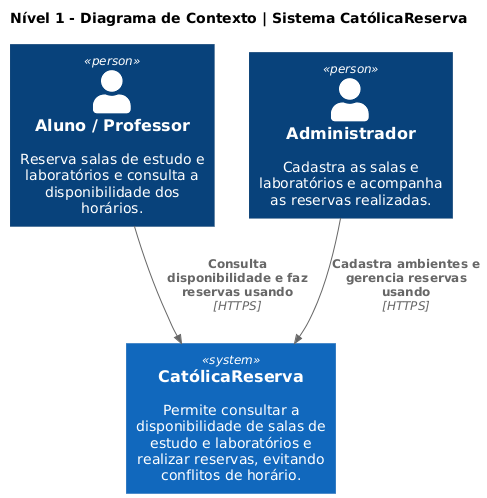
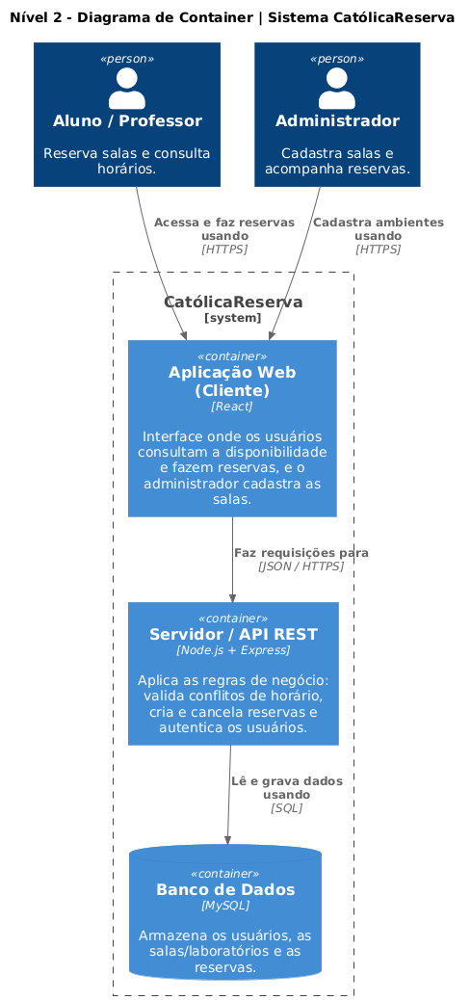
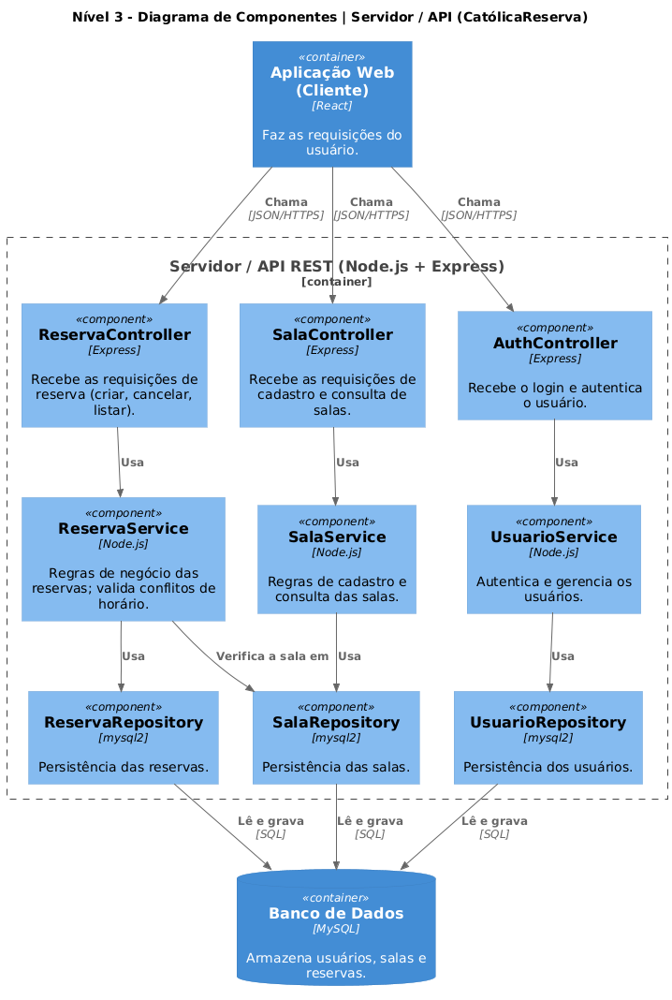
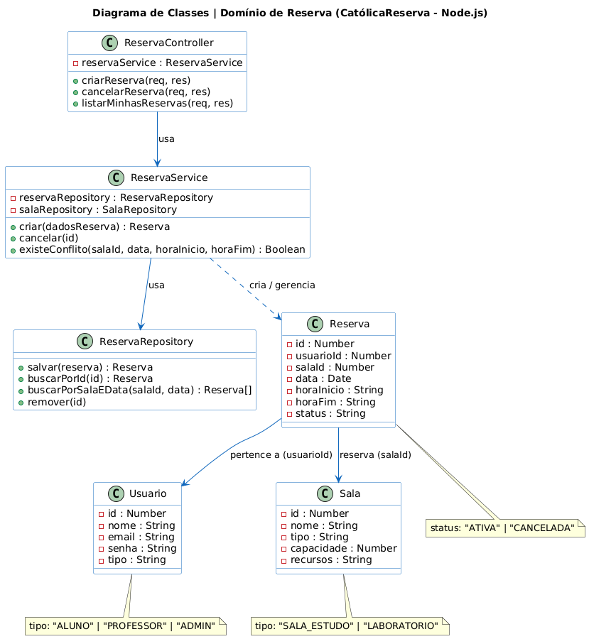

# CatólicaReserva — Sistema de Reserva de Salas de Estudo e Laboratórios

**Disciplina:** Projeto e Arquitetura de Software
**Integrantes:** Gustavo Schmitt e Heric Moreira Ribeiro

---

## Objetivo do projeto

O CatólicaReserva é um sistema para reservar salas de estudo e laboratórios de uma instituição de ensino. Hoje esse tipo de reserva costuma ser feito de forma informal (combinação entre alunos, planilhas ou controle manual), o que gera conflitos de horário e dúvidas sobre quais espaços estão livres.

O objetivo do projeto é oferecer um lugar único onde o aluno ou professor consegue ver quais salas estão livres em um determinado horário e fazer a reserva, evitando que duas pessoas reservem o mesmo espaço ao mesmo tempo. O sistema também serve como um projeto de aprendizado para aplicar na prática os conceitos de projeto e arquitetura de software.

## Público-alvo

O sistema é voltado para três tipos de usuário:

- **Aluno** — reserva salas de estudo e laboratórios para uso individual ou em grupo.
- **Professor** — reserva laboratórios e salas para aulas ou atividades.
- **Administrador** — cadastra as salas e laboratórios disponíveis e acompanha todas as reservas feitas.

## Requisitos funcionais

- **RF01** — Cadastrar usuários (aluno, professor e administrador).
- **RF02** — Autenticar o usuário por meio de login.
- **RF03** — Cadastrar salas e laboratórios, com capacidade e recursos disponíveis (projetor, computadores, etc).
- **RF04** — Consultar a disponibilidade de salas por data e horário.
- **RF05** — Reservar uma sala em um horário livre.
- **RF06** — Impedir duas reservas para a mesma sala no mesmo horário.
- **RF07** — Cancelar uma reserva.
- **RF08** — Visualizar as reservas feitas pelo próprio usuário.
- **RF09** — Permitir que o administrador visualize todas as reservas.

## Requisitos não funcionais

Os cinco requisitos não funcionais prioritários definidos para o projeto, com critérios mensuráveis:

- **RNF01 — Disponibilidade:** o sistema deve ficar disponível durante o horário de funcionamento (das 7h às 22h), com no máximo 1 hora de indisponibilidade por semana.
- **RNF02 — Desempenho:** a consulta de disponibilidade e a confirmação de uma reserva devem responder em até 2 segundos (p95), com até 50 usuários usando o sistema ao mesmo tempo.
- **RNF03 — Segurança:** o acesso só é permitido após login; as senhas são armazenadas de forma criptografada (hash) e cada usuário só acessa as próprias reservas, exceto o administrador.
- **RNF04 — Usabilidade:** um usuário novo deve conseguir fazer uma reserva em no máximo 3 telas/passos, sem precisar de treinamento.
- **RNF05 — Manutenibilidade:** qualquer integrante da dupla deve conseguir adicionar uma funcionalidade simples (ex: um novo tipo de sala) em até 1 dia, sem quebrar o que já existe.

## Ferramentas escolhidas

| Camada | Tecnologia | Motivo |
|---|---|---|
| Cliente (Frontend) | React | Biblioteca popular para criar a interface web, com bastante material de apoio. |
| Servidor (Backend) | Node.js + Express | Ambiente JavaScript no servidor; com o Express organiza a API REST em camadas (Controller/Service/Repository). |
| Banco de Dados | MySQL | Banco relacional simples e amplamente usado, adequado para os dados de usuários, salas e reservas. |
| Comunicação | API REST (JSON/HTTPS) | Forma padrão de comunicação entre o cliente e o servidor. |
| Modelagem | PlantUML / draw.io | Usados para desenhar os diagramas C4 e o diagrama de classes. |

As tecnologias podem sofrer pequenos ajustes ao longo do desenvolvimento.

## Arquitetura do projeto

O padrão de arquitetura escolhido foi o **Cliente-Servidor**.

Nesse padrão, a aplicação é dividida em duas partes: o **cliente** (a aplicação web em React, que o usuário acessa pelo navegador) e o **servidor** (a API em Node.js, que concentra as regras de negócio e o acesso ao banco de dados). O cliente faz requisições ao servidor por meio de uma API REST, e o servidor responde com os dados solicitados.

Motivos da escolha:

- **Centralização das regras e dos dados:** toda a lógica importante — em especial a validação de conflito de horário — fica em um único lugar (o servidor), o que evita que duas reservas sejam feitas para a mesma sala no mesmo horário.
- **Vários clientes, um servidor:** diferentes usuários acessam o mesmo servidor central a partir de seus navegadores, sempre com a mesma informação atualizada.
- **Separação de responsabilidades:** a interface (cliente) fica separada da lógica e dos dados (servidor), o que permite desenvolver e manter cada parte de forma independente — algo que ajuda a dupla a dividir o trabalho.
- **Simplicidade:** é um padrão simples de entender e implementar, adequado ao objetivo de aprendizado da disciplina.

Dentro do servidor, o código segue a organização em camadas (Controller → Service → Repository), detalhada no diagrama de componentes e no diagrama de classes abaixo.

## Modelo C4

O sistema foi documentado usando o Modelo C4, em três níveis (Contexto, Container e Componentes), além do diagrama de classes.

### Nível 1 — Contexto

Visão macro do sistema: mostra quem usa o CatólicaReserva e o que ele faz. Como o sistema é simples e não depende de serviços de terceiros, não há sistemas externos neste nível.

### Nível 2 — Container

"Abre a caixa" do sistema e mostra suas partes e tecnologias: a aplicação web (cliente), o servidor/API e o banco de dados.

### Nível 3 — Componentes

Detalha o container do servidor (API em Node.js), mostrando a organização em Controllers, Services e Repositories.

### Diagrama de Classes

Detalha as classes do domínio de reserva, seguindo a estrutura representada no C4 (Controller, Service, entidades e enums).

## Projeto desenvolvido até o momento

Até agora, a dupla concluiu a etapa de planejamento e documentação do sistema:

- Definição da visão do produto, do objetivo e do público-alvo.
- Levantamento dos requisitos funcionais e dos cinco requisitos não funcionais prioritários.
- Escolha da stack de tecnologias (React, Node.js e MySQL).
- Definição do padrão de arquitetura (cliente-servidor) e sua justificativa.
- Modelagem dos diagramas C4 (Contexto, Container e Componentes) e do diagrama de classes do domínio de reserva.

A implementação do código ainda não foi iniciada.

## Próximas etapas do desenvolvimento

- Modelar e criar o banco de dados MySQL (tabelas de usuários, salas e reservas).
- Implementar o servidor (API em Node.js com Express), começando pelo cadastro de usuários e salas.
- Implementar a regra de negócio central: a validação de conflito de horário nas reservas.
- Desenvolver a aplicação web (cliente em React) com as telas de login, consulta de disponibilidade e reserva.
- Integrar o cliente com a API e testar o fluxo completo de reserva e cancelamento.
- Realizar testes com base nos requisitos não funcionais (desempenho e disponibilidade).
